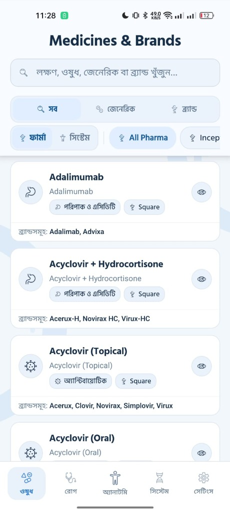
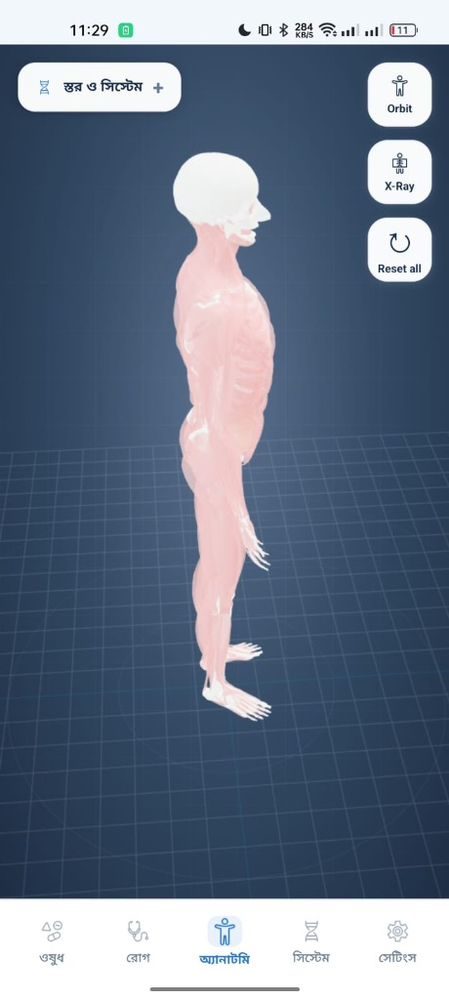
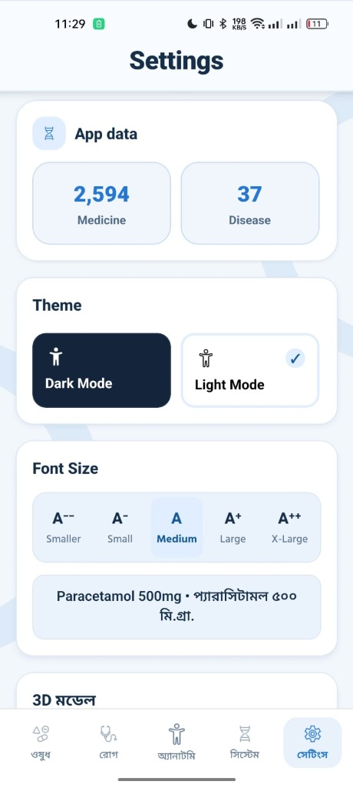
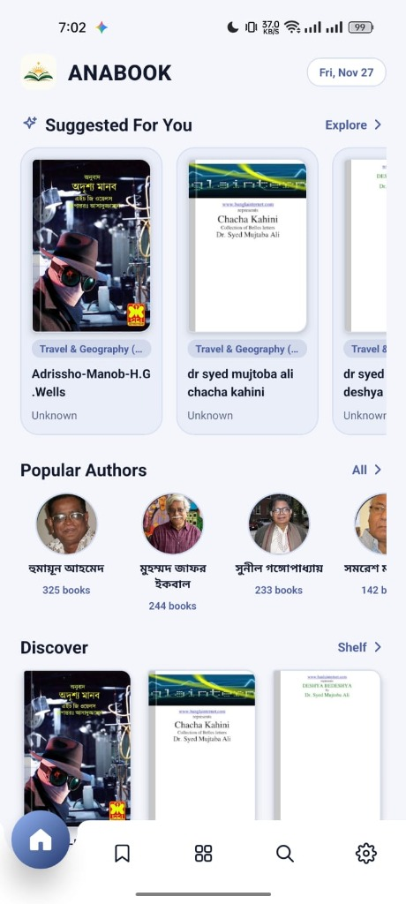
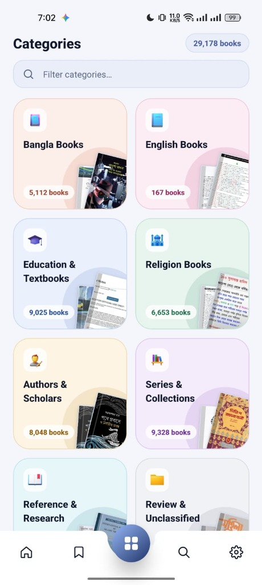
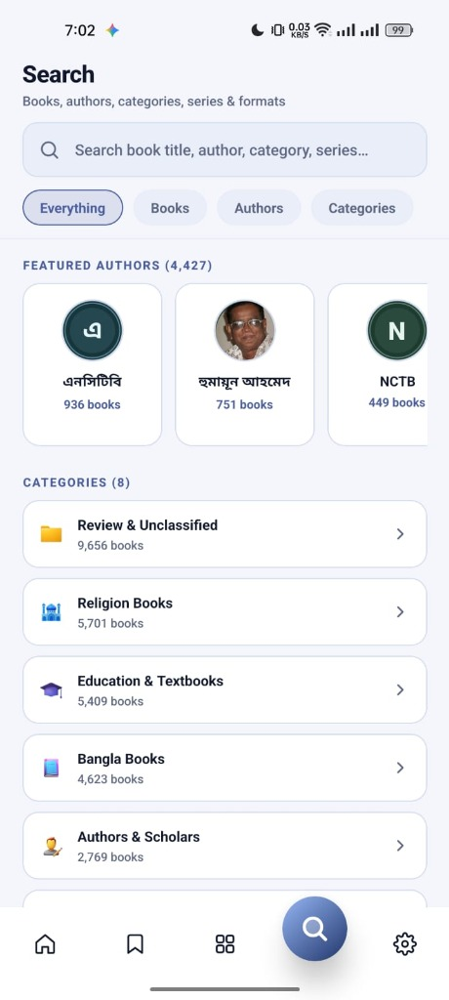
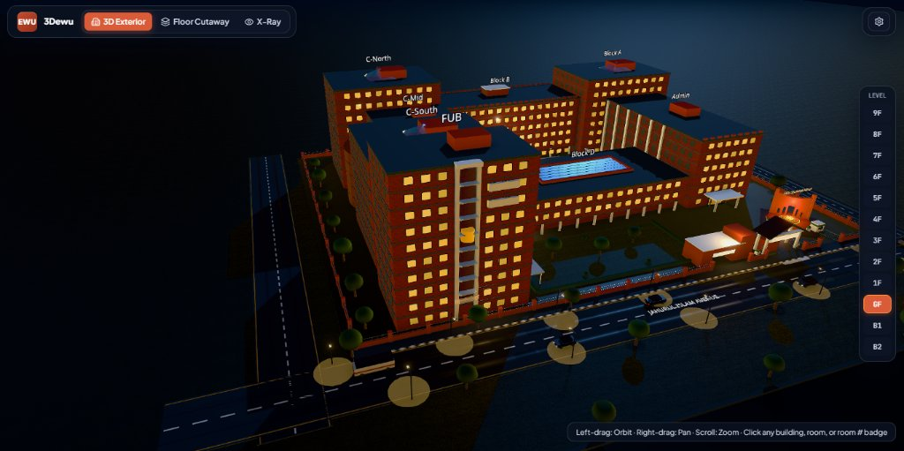

<div align="center">

# Salman Anik

### `CSE Student` · `AI & Data Science Enthusiast` · `Developer`

<p>
  <a href="https://www.linkedin.com/in/salmananik">
    
  </a>
  <a href="mailto:salmananik.bd@gmail.com">
    
  </a>
  <a href="https://portfolio-dun-nine-54.vercel.app/">
    
  </a>
  <a href="https://github.com/lasmanknia">
    
  </a>
</p>

</div>


---

## 🧑‍💻 About Me

I'm a **Computer Science & Engineering student at East West University**, graduating in **2027**.

I'm a CSE student interested in **Artificial Intelligence, Machine Learning, Data Mining, and Big Data Analytics**, and I'm building my foundation in programming, databases, and data analysis.

* 🎓 CSE @ **East West University**
* 🤖 Interested in **AI & Machine Learning**
* 📊 Exploring **Data Mining & Big Data Analytics**
* 🐍 Currently learning **Python**
* 🗄️ Working with **SQL & Databases**
* 🚀 Building my skills through practical projects
* 🎯 Goal: Turn data into useful insights and solutions
* 🕰️ Childhood GitHub Profile: [@lasmanknia](https://github.com/lasmanknia)

---

## 🛠️ Tech Stack

### Languages

<p>

</p>

### Web Development

<p>

</p>

### Data & Machine Learning

<p>

</p>

`Pandas` · `NumPy` · `Matplotlib` · `Scikit-learn`

### Database & Tools

<p>

</p>

---

## 📚 Currently Learning

```text
Python
  │
  └── Data Science
        ├── Data Analysis & Statistics
        ├── Artificial Intelligence
        ├── Machine Learning
        ├── Data Mining
        └── Big Data Analytics
```

---

## 🚀 Featured Projects

### 1. 🫀 [AnaPharm](https://github.com/salman-anik/AnaPharm) — 3D Human Anatomy & Bangladesh Medicine Database

<div align="center">

[](https://anapharm.vercel.app/)
[](https://github.com/salman-anik/AnaPharm)
[](https://github.com/salman-anik/AnaPharm/releases)

</div>

<p align="center">
  
  
  
</p>

An interactive 3D human anatomy and pharmaceutical reference application combining WebGL anatomical exploration, physiological simulations (heartbeat BPM, lungs, blood circulation), disease references, and an extensive Bangladesh pharmaceutical database:
* 🔬 **3D Human Anatomy:** Full-body model with 360° orbital rotation, layered dissection, exploded disassembly, and X-ray mode.
* 🫀 **Physiological Simulations:** Real-time animated heartbeat with adjustable BPM, pulmonary respiratory expansion, and animated blood flow particles.
* 💊 **Comprehensive Bangladesh Medicine Registry:** Over **33,200+ commercial medicine brands** and **2,594 generic medicines** with indications, dosage guidelines, precautions, and side effects in Bangla (Hind Siliguri typography).
* 📱 **Cross-Platform:** Available as a [Live Web Application](https://anapharm.vercel.app/) and standalone offline Android Release APK.

---

### 2. 📱 [AnaBook](https://github.com/salman-anik/AnaBook) — Offline-First Android eBook Reader

<div align="center">

[](https://anabook-bd.vercel.app/)
[](https://github.com/salman-anik/AnaBook)
[](https://github.com/salman-anik/AnaBook/releases/latest/download/AnaBook.apk)

</div>

<p align="center">
  
  
  
</p>

A standalone **React Native & Expo** Android reader app engineered to carry **29,178+ verified Bangla, English & NCTB academic books** offline in your pocket:
* 🎨 **5 Reading Themes & Custom Typography:** Espresso, Matcha, Midnight, Sepia, and Rosewood themes in Dark/Light modes with scalable typography.
* 📥 **Offline Shelf & Batch Folder Downloads:** Save entire classes, authors, or series collections for 100% offline reading with zero-duplication Drive shortcut indexing.
* 🔄 **Built-in In-App Updater:** Live progress bar APK downloader, native Android package installer trigger, and automatic temporary cache cleanup.

---

### 3. 🕊️ [Albartross SA](https://github.com/salman-anik/Albartross-SA) — 3D Procedural WebGL Flight Experience

<div align="center">

[](https://albartross-sa.vercel.app/)
[](https://github.com/salman-anik/Albartross-SA)

</div>

A procedural 3D WebGL flight experience built with **Three.js** and **Next.js**, where you glide as an albatross across endless islands, misty rivers, and open sea:
* 🌍 **Procedural World:** Infinite streaming terrain with islands, waterfalls, coastal foam, stone heads, pillars, obelisks, and rotating mini-map navigation.
* 🩷 **Companion Albatross:** A glowing pink partner bird with its own flight behavior—explore together when following it, or trigger side-by-side flight with the **Fly Together** button.
* 🌦️ **Dynamic Atmosphere:** Real-time day/night cycle, sun/moon arcs, stars, clouds, rain, wind gusts, snow accumulation, and sea ice floes.
* 📱 **Cross-Platform & Mobile Fullscreen:** Smooth keyboard/mouse controls and mobile touch drag-to-steer with hold-to-boost, plus fullscreen PWA support.

### 4. ✈️ Frustration — Supersonic 3D Fighter Jet & EWU Campus Simulator

<div align="center">

[](https://frustration-omega.vercel.app/)

</div>

A high-performance 3D fighter jet aerial strike and campus explorer simulator over **East West University (Aftabnagar, Dhaka)** built with **React Three Fiber**, **Three.js**, and **TypeScript**:
* ✈️ **Supersonic Aerodynamics & FX:** Realistic supersonic vapor cones, sonic shockwave bursts, Mach diamonds, slipstream ribbons, and afterburner smoke trails.
* 🎮 **Dual Jet & Walk Modes:** Pilot a fighter jet with combat effects and camera shake, or explore EWU buildings and the Aftabnagar cityscape on foot in 3rd-person.
* 🗺️ **Dual-Ring Tactical HUD & Radar:** Real-time dual-ring combat HUD, floor-aware minimap radar, full interactive Dhaka map modal, and realistic engine & SFX audio.
* 🌦️ **Dynamic Atmosphere & Presets:** Switch between **Day**, **Golden**, and **Night** lighting, dynamic weather, and 5 graphics quality tiers (`very-low` to `ultra`).

### 5. 🏛️ [ThreeDewu](https://github.com/salman-anik/ThreeDewu) — Interactive 3D EWU Campus Model

<div align="center">

[](https://threedewu.vercel.app/)
[](https://github.com/salman-anik/ThreeDewu)

</div>

<p align="center">
  
</p>

An interactive 3D architectural campus model of **East West University (EWU)** in Aftabnagar, Dhaka built with **React Three Fiber**, **Three.js**, and **TypeScript**:
* 🏢 **Full Campus Geometry:** Explore Block A, Block B, Block C (North, Mid, South), Block D, FUB, Admin, and surrounding campus grounds.
* 📐 **3D Exterior, Floor Cutaway & X-Ray Modes:** Inspect every level from **B2 to 9F** with clickable building and room badges.
* 🎓 **Detailed Interiors & GLB Export:** Features the Manzur Elahi Auditorium, CSE labs, library, classrooms, dynamic lighting presets, and one-click `.glb` 3D model export.

---

## 🗂️ Data Collection Projects

### 1. 🗄️ [Bangladesh Biggest Public Database](https://github.com/salman-anik/Bangladesh-Biggest-Public-Database) — Open-Source Public Data Infrastructure

<div align="center">

[](https://github.com/salman-anik/Bangladesh-Biggest-Public-Database)
[](https://github.com/salman-anik/Bangladesh-Biggest-Public-Database/blob/main/LICENSE)
[](https://github.com/salman-anik/Bangladesh-Biggest-Public-Database)

</div>

The largest open-source collection of structured Bangladesh public data, organizing fragmented civic, health, geographic, educational, and financial records into clean, machine-readable JSON and CSV formats.

#### 🗂️ Covered Domains & Datasets:
- **🏛️ Geography & Administration:** All 8 divisions, 64 districts, 495+ upazilas, unions, postal codes, and city corporations.
- **💊 Medicine & Pharmaceuticals:** 22+ MB standardized medicine database, brand names, generic formulas, dosage forms, and manufacturers.
- **🏦 Banking & Finance:** Complete Bangladesh Bank registered banks, branch networks (4.4 MB), routing numbers (4.5 MB), and MFS providers.
- **🏥 Healthcare:** Comprehensive hospital directory (2+ MB), doctor registries, blood banks, diagnostic centers, and ambulance services.
- **🎓 Education:** 40,000+ schools, colleges, and madrasas classified across all 8 administrative divisions with EIIN identifiers.
- **⚖️ Law & Justice:** Bangladesh Constitution, Penal Code 1860, CrPC 1898, major statutory acts, and legal glossary.
- **🚆 Transport & Routes:** Bangladesh Railway intercity trains, stations, route schedules, fare matrix, airports, and launch routes.
- **🚨 Emergency Contacts:** 24/7 national helplines (999, 333), police stations, and fire service desks.

* 🗄️ **Repository:** [salman-anik/Bangladesh-Biggest-Public-Database](https://github.com/salman-anik/Bangladesh-Biggest-Public-Database)
* 🚀 **Ready for:** Python Pandas, Data Science, AI/ML, NLP, Vector RAG, and Web/Mobile Applications

---

### 2. 📚 [Bangladesh Biggest eBook Library](https://github.com/salman-anik/Bangladesh-Biggest-eBook-Library) — Open-Access Digital Library

<div align="center">

[](https://anabook-bd.vercel.app/library)
[](https://salman-anik.github.io/Bangladesh-Biggest-eBook-Library/)
[](https://github.com/salman-anik/Bangladesh-Biggest-eBook-Library)

</div>

An open-access Next.js digital library & **319.4 GB Google Drive archive** indexing **29,178+ verified eBooks** and **19,254+ Series & Collections shortcut links**:
* 📖 **NCTB Textbooks & Academic Series:** Complete Class 1 to Class 12 curriculum alongside Hadith, Tafsir, Seerah, and classic Bangla series.
* 🤖 **Automated Drive Sync:** Python CI pipeline walking live Google Drive trees and publishing compact catalog updates for both the web portal and Android app.
* 🌐 **Instant Web Access:** Mobile-responsive Next.js Explorer deployed on both Vercel and GitHub Pages for fast filtering and 1-click previews.

---

## 🔥 Contribution Activity

<div align="center">


</div>

---

## 🐍 Contribution Snake

<div align="center">


</div>

---

## 🌐 Let's Connect

<div align="center">

<a href="https://www.linkedin.com/in/salman-anik-5a7015294">
  
</a>

<a href="mailto:salmananik.bd@gmail.com">
  
</a>

</div>

---

<div align="center">

### 💭 *Learning · Building · Improving*

**Thanks for visiting my profile! ⭐**

</div>
